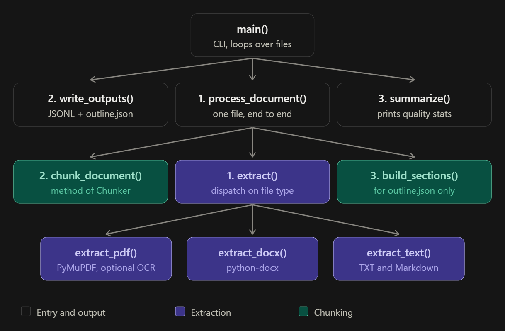

# doc_chunker: structure-aware chunking for financial documents

```bash
pip install -r requirements.txt
python doc_chunker.py annual_report.pdf loan_agreement.docx -o out/        # JSONL (default)
python doc_chunker.py report.pdf -o out/ --format json                     # JSON with doc-level info
python doc_chunker.py report.pdf --target-tokens 300 --max-tokens 400      # for 512-token encoders w/ headroom
python doc_chunker.py statements.pdf --table-strategy text                 # tables without ruling lines
python doc_chunker.py scan.pdf --ocr                                       # image-only pages
```

Outputs per document: `<name>.chunks.jsonl` (one chunk per line) and `<name>.outline.json` (detected section tree).
Python API: `process_document(Path, ChunkConfig) -> (chunks, outline, document_info)`.

## Pipeline



## Chunking strategy and why

**Size: target 400 tokens, hard max 512, min 100.**
- 512 is the input limit of many popular embedding models (BGE, E5, MiniLM family). The limit is applied to the *embedded* text, so the breadcrumb header's tokens are subtracted from every budget. Large-context embedders accept more, but retrieval quality generally favours focused chunks.

**Overlap: 50 tokens(~12%), whole sentences only, within a section only.**
- Overlap exists to rescue facts that straddle a boundary ("...subject to the following. [boundary] The Borrower shall..."). 10-15% is the usual sweet spot; more mostly duplicates storage and retrieval hits.

## Chunk schema (one JSON object per chunk)
```
{
    "chunk_id": "...",
    "doc_id": "...", 
    "chunk_index": "...", 
    "prev_chunk_id": "...", 
    "next_chunk_id": "...", 
    "source_file": "...", 
    "doc_title": "...",
    "section_path" : "list", 
    "section_title": "...", 
    "section_level": "...", 
    "sections_covered" : "when tiny sections were merged",
    "page_start": "...", 
    "page_end" (null for DOCX/TXT): "...", 
    "content_type" : "text|list|table|mixed", 
    "element_types": "...",
    "token_count": "...", 
    "char_count": "...", 
    "token_counter": "...", 
    "overlap_prefix_chars": "...", 
    "flags": "...", 
    "table": "table chunks only",
    "text": "...", 
    "contextualized_text": "...", 
    "content_hash": "..."
}
```